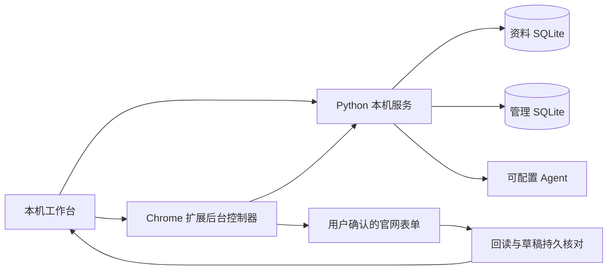

# 架构

唯一产品入口 `127.0.0.1:8768`。`prototypes/profile-lab/server.py` 托管资料、准备流程及静态前端，同源挂载 `/management/`。历史目录名保留以免破坏模块引用；不是三个独立产品。

- `profile-lab/lab.py`：资料字段、记录、版本、导入与原件。
- `requirements.py`、`mapping.py`、`application.py`：语义要求、引用校验、按对象组装材料。
- `preparation.py`、`site_scan.py`、`executor_bridge.py`：官网扫描、本次预览、确认、会话与执行回报。
- `job_sessions.py`：岗位独立归属、材料复用、两库事务删除。
- `management-lab/store.py`：岗位、人工日期和状态；`intake.py` 解析候选。
- `official.py`、`public_jobs.py`、`resolution.py`：来源分析、公开官网与岗位核验、可接续任务。
- `recognizer.py`、`agent_adapter.py`：默认 Codex 与自选 JSON Agent，输出继续接受业务验证。
- `icbc-native-extension/`：单后台控制器、票据、当前官网页、通用／专用控件驱动及材料运行器。

启动票据短效、单次领取、绑定会话和扩展 origin。只有预览确认后的材料进入执行轮询。Chrome 工作台直连扩展；其他浏览器用专用中转页，不重复创建控制页。

模型不直接点击网站。扩展不内置申请人资料或模型密钥，接收已解析、确认的材料。复杂控件按真实 DOM 驱动，不按公司硬编码答案。暂存后重载同一页面，按分区、记录序号和字段语义核对持久值。

本机开发服务不是多租户部署架构。自选 Agent 进程是用户信任的程序，capabilities 只是契约，需包装器落实执行限制。
